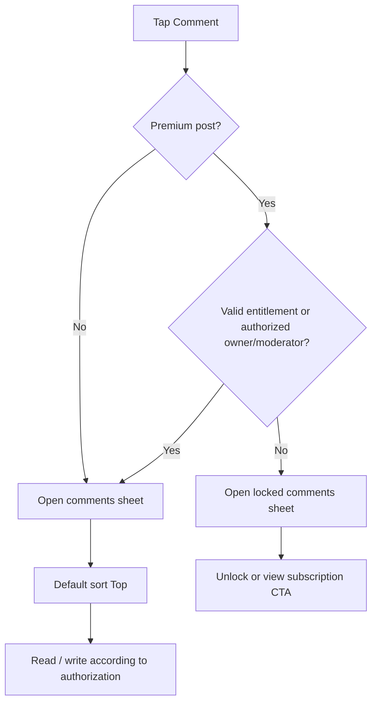
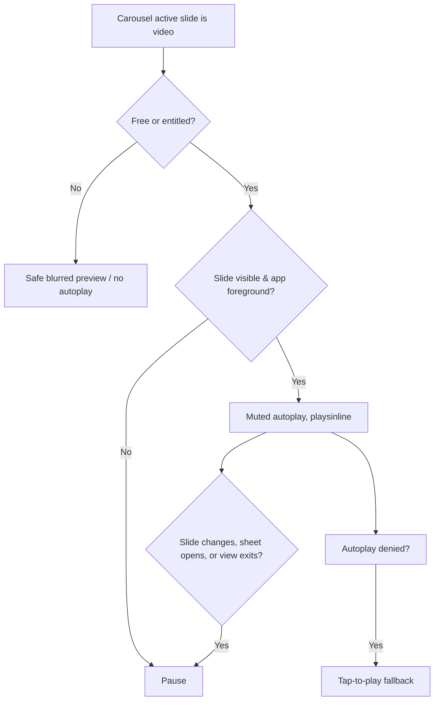
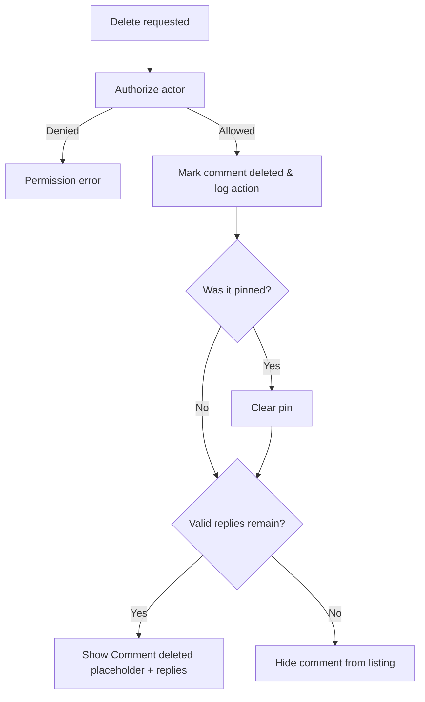

# INFLUENCY — Mobile-First UI/UX Specification

**Versi:** 1.0  
**Tanggal:** 4 November 2026  
**Status:** Rangkuman keputusan desain dan requirement UX yang disepakati sepanjang diskusi.  
**Fokus:** Web-first, mobile-first, *native-app-like*, Dark Social; App Shell, Home Feed, Creator Profile, User Area, Post Card, Media, dan Comment Management.

> **Cara membaca status**  
> **LOCKED** = eksplisit dipilih/ditetapkan dalam diskusi.  
> **DRAFT / USULAN** = konsep yang dibahas atau disarankan, belum diputuskan sebagai aturan final.  
> **OPEN** = membutuhkan keputusan desain/produk lanjutan.  
> Dokumen ini adalah spesifikasi UI/UX, bukan pengganti dokumen aturan keuangan, kepatuhan, dan arsitektur sistem.

---

## 1. Product & Design Direction

### 1.1 Identitas pengalaman — LOCKED

- **Platform:** Influency, website independen yang dapat diakses langsung dari browser maupun browser in-app (misalnya link bio Instagram/TikTok).
- **Pendekatan:** *Mobile-first* dengan tampilan dan interaksi seperti aplikasi native, **bukan** ketergantungan pada Telegram Mini App.
- **Visual direction:** **Dark Social** (dark mode saja): latar hampir hitam, kartu abu gelap bersudut besar, aksen kuning lemon untuk CTA, chip aktif berupa pil putih, tombol berbentuk pil; media/creator sebagai fokus utama, mudah digunakan seperti aplikasi sosial. *(Diperbarui 2026-11-04 atas keputusan user, berdasarkan referensi desain aplikasi gelap: menggantikan "B — Dark Social" dan palet PetalSkull.)*
- **Prioritas entry point:** profil creator dapat dibuka langsung dari tautan creator tanpa landing page tambahan.
- **Navigasi utama:** App Shell dengan top navbar, bottom navigation, dan right account sidebar.

### 1.2 Design tokens awal — DRAFT

Referensi: desain aplikasi gelap dengan aksen kuning lemon (diberikan user 2026-11-04). **Dark mode saja**, tanpa tema terang atau toggle. Nilai hex di bawah adalah perkiraan dari gambar referensi dan masih bisa diubah.

| Token | Usulan | Status |
|---|---|---|
| Canvas | Hampir hitam, contoh `#121212` | DRAFT |
| Surface | Abu gelap, contoh `#232323` (kartu, sheet, popover) | DRAFT |
| Main text | Putih lembut, contoh `#F5F5F5` | DRAFT |
| Muted text | Abu, contoh `#A3A3A3` (≥ 4,5:1 di canvas, surface, dan muted) | DRAFT |
| Muted / chip | Abu gelap, contoh `#2C2C2C` (chip tidak aktif, hover) | DRAFT |
| Primary accent | Kuning lemon, contoh `#F8F43C` — CTA utama, ikon aktif, ring fokus; teks di atasnya hampir hitam `#121212`, **bukan** putih (±1,1:1) | DRAFT |
| Secondary | Pil putih `#F5F5F5` dengan teks `#121212` (chip/tab aktif) | DRAFT |
| Border | `#2E2E2E` | DRAFT |
| Koin color | Sementara sama dengan kuning primary `#F8F43C` (token terpisah, bisa dipisah nanti) | DRAFT |
| Success | Hijau terang, contoh `#4ADE80` | DRAFT |
| Destructive | Merah terang, contoh `#FF6467` (teks error ≥ 4,5:1 di canvas) | DRAFT |
| Bentuk | Tombol berbentuk pil; radius dasar 12 px (kartu ±22 px) | DRAFT |
| Font | Inter atau Plus Jakarta Sans | DRAFT |
| Mobile design baseline | 375–390 px; uji layar 320–430 px | DRAFT |
| Tap target | Sekitar 44 × 44 px minimal | DRAFT |
| Desktop feed max width | Sekitar 480–560 px | DRAFT |

Desain akhir harus memperhitungkan *safe area*, `100dvh`, toolbar browser in-app, performa perangkat mobile, dan aksesibilitas.

---

## 2. App Shell & Navigasi

### 2.1 Top Navbar — spesifikasi pengguna

**Susunan:**

1. Kiri: logo **Influency**.
2. Kanan: ikon **Search/Discover** → membuka halaman Discover.
3. Kanan: ikon **initial user** → membuka account sidebar dari **kanan**.

**Scroll behavior yang diminta:** **navbar disembunyikan saat scroll ke atas, ditampilkan saat scroll ke bawah**.

> **Catatan UX:** arah tersebut memang kebalikan dari konvensi mobile yang lazim. Jangan membaliknya diam-diam pada implementasi. Uji secara visual/gesture sebelum final QA. Bottom bar memiliki aturan tersendiri.

### 2.2 Bottom Navigation — LOCKED

**Urutan persis:**

1. **Home**
2. **Notification**
3. **Discover**
4. **Wallet**
5. **Profile**

**LOCKED: Bottom bar selalu terlihat di halaman aplikasi normal, termasuk profil creator yang dibuka melalui direct link dari luar / link bio.** Tidak memakai perilaku *Focused External Entry* yang menyembunyikan bottom bar.

Pembedaan aksi:

- Bottom **Profile** → langsung ke halaman profil diri sendiri (creator profile jika creator; user profile jika non-creator).
- Top navbar **user initial** → membuka right sidebar, bukan langsung pindah profil.
- Bottom **Discover** dan top **Search/Discover** → tujuan Discover yang sama (rincian search UX masih OPEN).
- Bottom **Wallet** dan wallet shortcut pada sidebar → tujuan wallet yang sama.
- **Creator onboarding** adalah halaman standalone tanpa App Shell, sesuai keputusan onboarding; ini bukan halaman aplikasi normal.

**DRAFT perilaku:** bottom bar diposisikan fixed/sticky, memiliki active indicator, dan memperhitungkan iOS/Android safe area. Tampilan video fullscreen/checkout khusus belum dirinci, sehingga jangan memaksakan pengecualian visibilitas baru tanpa keputusan.

### 2.3 Right Sidebar — spesifikasi pengguna

Isi sidebar secara vertikal:

1. Avatar, display name, username.
2. Wallet, jumlah saldo **Koin**, tombol **Buy Koin**.
3. **My Profile** (ditambahkan kemudian; posisi setelah wallet adalah usulan penempatan).
4. **Become a Creator** (hanya ditampilkan jika akun belum menjadi creator).
5. **My Collection**.
6. **Following**.
7. **Subscriptions**.
8. **Settings**.
9. **Logout**.

**LOCKED tentang My Profile:** mengarah ke halaman profil milik sendiri sesuai status creator/non-creator. Detail posisi persis menu tambahan My Profile relatif terhadap item lain dapat disempurnakan dalam UI QA.

**DRAFT interaction:** drawer slide-in dari kanan, overlay, tutup via X / klik backdrop / gesture, dan pemisahan identitas akun dari item navigasi. Standalone onboarding tidak menggunakan navbar/sidebar/bottom bar.

### 2.4 Usulan routing — DRAFT, bukan kontrak final

| Route contoh | Tujuan |
|---|---|
| `/` | Home Feed |
| `/notifications` | Notifications |
| `/discover` | Discover |
| `/wallet` | Wallet |
| `/me` | My Profile sesuai role |
| `/collection` | My Collection |
| `/following` | Following |
| `/subscriptions` | Subscriptions |
| `/creator/onboarding` | Standalone creator onboarding |
| `/[username]` | Public Creator Profile |

Disarankan menggunakan satu App Shell bersama agar posisi feed, navbar, dan sidebar stabil saat berpindah halaman.

---

## 3. Halaman Pengguna (User Area)

### 3.1 My Collection — spesifikasi pengguna

**Isi:** seluruh konten yang di-**like** dan konten yang **purchased** oleh pengguna.

**Kontrol:**

- Filter berdasarkan **creator**.
- Filter kategori: **Liked** dan **Purchased** (serta keadaan All untuk seluruh koleksi).
- Filter tipe media: **All Content / Image / Video**.
- **Sort** (pilihan sort spesifik masih OPEN).
- **Display**: **Grid** atau **Vertical** (vertical dapat memakai komponen Post Card yang sama dengan feed).

Satu post yang di-like sekaligus purchased sebaiknya muncul **sekali** pada hasil **All** (**DRAFT implementasi deduplikasi**). Hak akses terhadap media tetap mengikuti entitlement; like bukan pembelian.

### 3.2 Following — spesifikasi pengguna

**Isi:** daftar semua creator yang user follow (follow adalah relasi sosial, terpisah dari subscription berbayar).

**Kontrol:** sort dan toggle display **Grid / Vertical**.

**Creator Card:** cover, avatar, name, username, bio.

Pilihan sort, aksi follow/unfollow dari kartu, dan detail keadaan kosong belum dikunci.

### 3.3 Subscriptions — spesifikasi pengguna

**Isi:** daftar creator yang di-subscribe, dengan penyajian lebih sederhana daripada Following.

**LOCKED:** **tanpa sort dan tanpa toggle display** seperti Following.

**DRAFT:** bedakan subscription active, scheduled renewal, dan expired sesuai sistem monetisasi. Rincian isi kartu/CTA belum final.

### 3.4 Become a Creator — LOCKED

- Halaman khusus **creator onboarding**.
- **Standalone** seperti landing/login; **tanpa layout App Shell**.
- Menu hanya ditampilkan untuk non-creator.
- Detail langkah onboarding, verifikasi, dan input belum dibahas.

### 3.5 Settings — DEFERRED

Halaman Settings secara eksplisit **ditunda**; tidak dirancang dalam scope pembahasan ini.

---

## 4. My Profile & Creator Profile

### 4.1 Profile Header — spesifikasi pengguna

Untuk profil milik sendiri, baik user maupun creator:

- **Cover image**.
- **Avatar**.
- **Display name**.
- **Username**.
- **Edit Profile** button.

Untuk profil creator yang dilihat pengunjung, **Edit Profile** tidak ditampilkan; CTA pengunjung seperti Subscribe mengikuti entitlement/role. Tab dan detail di bawah header **profil user non-creator masih OPEN**.

### 4.2 Creator Profile Tabs — LOCKED

Profil creator memiliki **dua tab:**

- **Posts**.
- **Grid** (sebelumnya disebut *Media*, tetapi nama terbaru yang diminta pengguna adalah *Grid*).

Ini **menggantikan** keputusan awal *Social Feed Only*. Dua tab harus hadir secara bersamaan.

### 4.3 Creator Profile — Posts Tab — spesifikasi pengguna

- Posting ditampilkan **secara vertikal**, satu post per kartu.
- Setiap post menampilkan **tanggal post**, **caption**, dan **media carousel**.
- **Multiple photos** tampil dalam carousel horizontal.
- Carousel mempunyai **right-offset/right peek**: sebagian slide berikutnya tampak di sisi kanan.
- Di bawah media, kiri: **Like, Comment, Share**.
- Di kanan: **Send Tip**, **hanya** saat viewer eligible dan post memenuhi aturan tip.
- Untuk premium locked: preview aman + tindakan Unlock (detail bottom sheet belum dirancang).

Post Card yang sama dipakai di Home dan tampilan koleksi vertikal, dengan action/menu sesuai konteks. Pada post milik creator, menu bisa memuat Edit/Archive (detail modifikasi post masih OPEN).

### 4.4 Creator Profile — Grid Tab — spesifikasi pengguna

**Grid hanya menampilkan thumbnail media tanpa caption.** Foto dan video keduanya masuk ke grid.

Terdapat **dua kelompok filter**:

1. **Media Type:** `All` / `Image` / `Video`.
2. **Access Type:** `All Media` / `Free` / `Premium`.

Kedua filter bekerja **bersamaan**. Contoh: `Video + Premium` hanya menampilkan media video dari premium posts.

**DRAFT presentasi:** tiga kolom thumbnail rasio 1:1, gap 2–3 px; ikon play pada video; ikon lock + preview blur untuk konten terkunci; satu tile untuk setiap item media (beberapa tile dapat merujuk post yang sama).

**OPEN:** saat tile diketuk, apakah membuka fullscreen media viewer atau Post Detail. **Belum diputuskan.**

### 4.5 Paid media & entitlement di Profile

- Premium post yang belum diakses hanya mendapat **thumbnail/preview blur yang aman**, bukan file original.
- User yang membeli post secara individual mempertahankan entitlement sesuai kebijakan pembelian premium yang sebelumnya dikunci.
- Subscriber memperoleh akses pada post eligible selama hak subscription berlaku; arsip mengikuti aturan archived-access grant.
- Media yang diarsipkan tidak ditampilkan lagi di profil publik; pembeli individual tetap dapat mengakses dari area pembelian selama legal dan tersedia.

---

## 5. Home Feed — LOCKED Decisions

### 5.1 Home Tabs

Home memiliki **dua tab**:

1. **For You** — rekomendasi posting dari berbagai creator.
2. **Following** — posting dari creator yang di-follow.

**Default Home Tab: For You — LOCKED.** Setiap navigasi/masuk kembali ke Home membuka For You; **tidak** mengingat tab terakhir sebagai default pada pembukaan ulang Home.

**DRAFT:**

- For You dapat memakai rekomendasi sederhana berbasis freshness/engagement/keragaman creator, belum ada formula locked.
- Following dapat memakai chronological newest-first, belum menjadi aturan final.
- Kedua feed menggunakan infinite scroll, pagination dan komponen Post Card yang sama.
- Posisi scroll masing-masing tab dapat dipertahankan selama halaman Home tetap aktif.
- Jika user belum follow creator: tampilkan empty state + CTA Discover.
- Guest dapat melihat preview yang aman; tindakan yang butuh akun meminta login (detail guest flow belum dikunci).

### 5.2 Hubungan Follow vs Subscribe

**Follow** merupakan relasi sosial gratis; **Subscribe** adalah entitlement premium berbayar. **Jangan otomatis menyamakan keduanya.** Apakah subscribe otomatis mem-follow creator belum diputuskan.

---

## 6. Reusable Post Card

### 6.1 Urutan komponen — spesifikasi desain

```text
PostCard
├── Creator Header
│   ├── Avatar
│   ├── Display Name / Username
│   ├── Post Date
│   └── Contextual menu (+ Follow pada For You jika diperlukan)
├── Caption
├── Media Carousel
│   ├── Swipe horizontal, next-slide right peek
│   ├── Image / Video
│   └── Free / Premium Locked / Premium Unlocked
├── Engagement Row
│   ├── Left: Like · Comment · Share
│   └── Right: Send Tip (jika eligible)
└── Monetization CTA
    └── Unlock Post (jika premium locked)
```

**Dipakai pada:** Home For You, Home Following, Creator Profile Posts, My Collection Vertical.

**DRAFT:** satu media tampil penuh tanpa right peek; multi-media carousel menampilkan right peek dan pagination indicator. Satu premium post dibeli sebagai satu unit yang membuka seluruh media di post tersebut (perlu dikonfirmasi ke *Content Model* bila belum diputuskan secara terpisah).

### 6.2 Post media states

| State | Media | Interaksi utama |
|---|---|---|
| Free | Media dapat dilihat | Like, comment, share sesuai login; tidak ada unlock |
| Premium locked | Blurred preview, no original video | Unlock / Subscription; komentar private |
| Premium unlocked | Media sebenarnya | Like, comment, share; Tip jika eligible |

**Aturan tips yang harus dipertahankan:** tip tersedia pada **profil creator** atau **premium post yang sudah dapat diakses**, hanya bagi pengguna dengan subscription aktif **atau** pernah membeli setidaknya satu premium post dari creator yang sama. **Tidak** menampilkan Send Tip pada free post. Tidak ada self-tip. Tip tidak memberikan entitlement baru.

**OPEN:** apakah pengguna tanpa entitlement boleh memberi Like pada premium locked post. Komentar premium sudah locked private (lihat §8).

### 6.3 Video Playback — LOCKED: Option B, Muted Autoplay

- Video **free** autoplay **muted** ketika terlihat di viewport.
- Video **premium unlocked** autoplay **muted** ketika terlihat di viewport dan memiliki entitlement valid.
- Video **premium locked tidak autoplay** dan hanya menampilkan blurred preview.
- Auto-play hanya untuk **slide video aktif** pada carousel.
- Pause ketika slide berganti, media keluar viewport, tab browser di background, atau Comments Bottom Sheet terbuka.
- Maksimal **satu video autoplay aktif** pada satu waktu.
- Implementasi memakai `muted`, `playsinline`, visibility observer, lazy-loading, serta fallback **tap-to-play** jika browser menolak autoplay.

**DRAFT tambahan:** tersedia kontrol mute/unmute; preload thumbnail berikutnya tetapi hindari preload video penuh yang belum ditonton; threshold visibilitas exact belum LOCKED.

### 6.4 Engagement actions

- **Like Post:** toggle dengan indikator aktif; login dibutuhkan untuk mutation; kebijakan locked-premium Like masih OPEN.
- **Comment:** membuka **Comments Bottom Sheet** (LOCKED), feed scroll position tetap tersimpan.
- **Share:** share URL **post**, bukan URL langsung media premium; usulan menggunakan native share dan fallback copy URL.
- **Send Tip:** CTA ke bottom sheet tip (desainnya belum dirinci), hanya sesuai eligibility.
- **Unlock:** CTA ke bottom sheet premium unlock (desainnya belum dirinci), validasi saldo/entitlement/transaksi atomik.
- **More (`···`):** contextual menu berbeda untuk viewer vs creator pemilik post (rincian post editing/archiving masih terbuka).

---

## 7. Comments Bottom Sheet — FINAL Core UX

### 7.1 Comments Container — LOCKED

- Tap icon **Comment** membuka **bottom sheet**, **bukan** navigasi ke Post Detail.
- Feed di belakang tetap mounted dan mempertahankan posisi scroll.
- Bagian sheet: **drag handle + header**, **comment list** dengan sorting, dan **sticky composer**.
- Menutup sheet mengembalikan pengguna ke post dan posisi scroll semula.
- Video yang autoplay di belakang dipause selama sheet terbuka.

**DRAFT UI detail:** sheet dapat di-swipe down untuk tutup; tinggi sekitar 75–90% layar; keyboard tidak menutupi composer; bottom bar tetap milik App Shell di belakang overlay. Ukuran dan gestur final masih dapat disesuaikan.

### 7.2 Private Premium Comments — LOCKED

**Hanya pengguna dengan entitlement valid yang dapat membaca *atau* menulis komentar premium post.**

- Premium locked: tap Comment membuka locked/paywall state, **tanpa** isi komentar/reply.
- Entitlement sah dapat berasal dari **post purchase**, **subscription aktif** untuk post eligible, atau **archived-access grant** yang belum habis.
- Creator pemilik post dan admin berwenang merupakan pengecualian terbatas untuk manajemen/moderasi.
- Jika subscription expired tanpa entitlement lain, akses komentar premium dihentikan. Komentar lama tidak perlu dihapus hanya karena akses pemiliknya berakhir.
- **Backend wajib mengecek akses untuk read maupun mutation**, tidak hanya menyembunyikan UI.
- Tidak boleh membocorkan body/reply premium melalui cache publik, search, preview notifikasi, atau endpoint alternatif.

**DRAFT free-comment permission:** guest boleh membaca komentar free post tetapi harus login untuk menulis.

### 7.3 Sorting — LOCKED

- Dua mode: **Top** dan **Recent**.
- **Default: Top setiap kali Comments Bottom Sheet dibuka.**
- **Recent:** komentar paling baru lebih dulu.
- **Top:** komentar berdasarkan engagement/relevansi; formula numerik masih OPEN.
- Sort berlaku untuk komentar utama; usulan reply tetap melekat pada parent dan tidak dipisah.
- **Pinned comment selalu tampil paling atas di kedua mode**, tanpa duplikasi.

### 7.4 Replies — core functionality

- Ada komentar utama dan reply; reply mendukung Like/Unlike, Edit (oleh penulis), Delete (sesuai izin), serta Reply dalam thread.
- **DRAFT:** maksimal satu tingkat nesting visual untuk kenyamanan layar kecil, dengan relasi `parentCommentId`.
- Reply valid tetap ditampilkan bila parent sudah dihapus.

### 7.5 Comment & Reply Likes — LOCKED

- **Komentar utama dan reply** dapat di-Like dan di-Unlike.
- Tampilkan total likes dan active state (aksen kuning primary ketika liked).
- Satu akun maksimal satu like per komentar/reply.
- Perubahan UI dapat optimistic dengan rollback bila gagal (**DRAFT implementasi**).
- User harus login untuk like; premium comment likes hanya jika entitlement valid.
- Komentar yang sudah dihapus tidak bisa menerima like baru; reply valid di bawah deleted parent tetap bisa di-like.

### 7.6 Editing — LOCKED: Edit Anytime

- Hanya **author** yang boleh mengedit teks komentar/reply miliknya.
- **Tidak ada batas waktu edit.**
- Setelah diedit, UI menampilkan label **Edited**.
- Creator/admin **tidak** boleh menyunting isi komentar orang lain.
- Komentar/reply yang sudah dihapus tidak bisa diedit.
- Untuk post premium, author tetap memerlukan akses entitlement saat mencoba mengedit (kecuali hak akses role khusus yang sah).
- **DRAFT UI:** inline editor dalam sheet, Save/Cancel, mempertahankan draft ketika gagal kirim.

### 7.7 Moderation & Deletion — LOCKED

| Aktor | Izin |
|---|---|
| Penulis komentar | Menghapus komentar/reply miliknya sendiri |
| Creator pemilik post | Menghapus komentar/reply siapa pun pada post miliknya |
| Platform admin | Moderasi komentar di seluruh platform |
| Viewer lain | Tidak dapat menghapus komentar orang lain |

**Preserve Replies — LOCKED:**

- Jika **parent comment** dihapus dan masih ada reply valid, tampilkan placeholder **`Comment deleted`**.
- Reply yang masih valid **tetap ditampilkan**.
- Jika parent dihapus dan tidak memiliki reply valid, parent dapat disembunyikan seluruhnya dari list.
- Konten teks yang dihapus tidak boleh muncul kembali pada response UI, cache, atau notifikasi.
- **DRAFT:** soft delete + audit log, konfirmasi sebelum deletion, tidak mengizinkan reply baru secara langsung ke parent yang telah dihapus.
- Kewenangan penghapusan tidak memberi hak untuk mengedit isi komentar orang lain.

### 7.8 Pin Comment — LOCKED

- **Maksimal satu pinned comment utama (top-level) per post.**
- **Hanya creator pemilik post** dapat Pin/Unpin.
- Tidak dapat pin reply.
- Pinned comment berada **paling atas** untuk sorting Top maupun Recent.
- Jika pinned comment dihapus, pin otomatis dicabut.
- **DRAFT:** pin komentar baru menggantikan pin sebelumnya secara atomik; item pinned mendapat label *Pinned by creator*.

### 7.9 Moderation / comment menus — rancangan

| Aksi | Penulis | Creator pemilik post | Admin | Viewer lain |
|---|---|---|---|---|
| Reply | Ya* | Ya* | Ya* | Ya* |
| Like/Unlike | Ya* | Ya* | Ya* | Ya* |
| Edit komentar sendiri | Ya | Ya (komentar sendiri) | Ya (komentar sendiri) | Ya (komentar sendiri) |
| Delete komentar sendiri | Ya | Ya | Ya | Tidak |
| Delete komentar orang lain | Tidak | Ya | Ya | Tidak |
| Pin/Unpin komentar utama | Hanya jika juga pemilik post | Ya | Tidak otomatis | Tidak |
| Report komentar | DRAFT | DRAFT | DRAFT | DRAFT |

\* Tunduk pada autentikasi dan hak akses konten premium.

### 7.10 Comment API & data modeling — DRAFT implementasi

```ts
type Comment = {
  id: string;
  postId: string;
  authorId: string;
  parentCommentId: string | null;
  body: string | null;
  createdAt: Date;
  updatedAt: Date;
  editedAt: Date | null;
  deletedAt: Date | null;
  deletedById: string | null;
};

type CommentLike = {
  userId: string;
  commentId: string;
  createdAt: Date;
};

type PostCommentPin = {
  postId: string; // UNIQUE: maksimal 1 pin per post
  commentId: string; // wajib top-level, aktif, pada post yang sama
  pinnedById: string;
  pinnedAt: Date;
};
```

Endpoint konseptual:

```http
GET    /posts/:postId/comments?sort=top|recent
POST   /posts/:postId/comments
PATCH  /comments/:commentId
DELETE /comments/:commentId
POST   /comments/:commentId/likes
DELETE /comments/:commentId/likes
PUT    /posts/:postId/pinned-comment
DELETE /posts/:postId/pinned-comment
```

Semua `GET`/mutation premium membutuhkan server-side entitlement check; creator/admin moderation memakai otorisasi terpisah. `CommentLike` unik per pasangan `(userId, commentId)`. Pin dan removal bersifat atomic/idempotent. Audit perubahan moderasi harus tercatat. Kontrak dan nama endpoint final menunggu desain backend.

---

## 8. Interaction Flows

### 8.1 Open premium comments



### 8.2 Video playback in feed



### 8.3 Delete parent comment



---

## 9. Acceptance Criteria / QA Checklist

### Navigation

- [ ] **NAV-01** Navbar memiliki logo di kiri, Search/Discover dan user initial di kanan.
- [ ] **NAV-02** User initial membuka drawer dari kanan; bottom Profile membuka profil sendiri.
- [ ] **NAV-03** Bottom bar urut Home, Notification, Discover, Wallet, Profile.
- [ ] **NAV-04** Bottom bar tampil pada Creator Profile dari external bio link.
- [ ] **NAV-05** Become a Creator hanya untuk non-creator dan tampil standalone tanpa App Shell.
- [ ] **NAV-06** Scroll behavior navbar mengikuti arah yang ditulis pengguna (hide on scroll up, show on scroll down), sambil dievaluasi UX-nya.

### Home & Profile

- [ ] **HOME-01** Home menyediakan For You dan Following.
- [ ] **HOME-02** Masuk kembali ke Home selalu membuka For You.
- [ ] **HOME-03** Following menampilkan konten hanya dari creator yang di-follow.
- [ ] **PRO-01** Profil sendiri memuat cover, avatar, display name, username, dan Edit Profile.
- [ ] **PRO-02** Creator Profile memiliki tepat dua tab: Posts dan Grid.
- [ ] **PRO-03** Posts vertikal menampilkan tanggal, caption, carousel right peek, Like/Comment/Share kiri, Tip kanan bila eligible.
- [ ] **PRO-04** Grid tidak memuat caption; filter media All/Image/Video × All Media/Free/Premium bekerja bersamaan.
- [ ] **COL-01** My Collection bisa filter creator, Liked/Purchased, tipe media, sort, dan Grid/Vertical.
- [ ] **FOL-01** Following menampilkan cover, avatar, name, username, bio; sort dan Grid/Vertical.
- [ ] **SUB-01** Subscriptions ditampilkan sederhana, tanpa sort/display toggle.

### Media & Post

- [ ] **MED-01** Multi-media post dapat di-swipe horizontal; right peek tampak.
- [ ] **MED-02** Video free/autorisasi premium muted autoplay hanya saat terlihat dan slide aktif.
- [ ] **MED-03** Video locked tidak autoplay dan file original tidak dikirim kepada viewer tanpa entitlement.
- [ ] **MED-04** Video offscreen, di background, atau di bawah comments overlay dipause.
- [ ] **MED-05** Maksimal satu autoplay video aktif sekaligus; fallback jika autoplay diblokir.
- [ ] **POST-01** Send Tip tidak muncul pada free post, self-post, atau untuk viewer tidak eligible.

### Comments

- [ ] **CMT-01** Comment membuka bottom sheet tanpa navigasi dan menjaga posisi feed.
- [ ] **CMT-02** Default sorting Top; mode Recent tersedia.
- [ ] **CMT-03** Premium locked comments tidak mengembalikan isi komentar/reply tanpa entitlement.
- [ ] **CMT-04** Comment dan reply mendukung like/unlike dan count/status yang benar.
- [ ] **CMT-05** Author dapat mengedit komentar/reply sendiri kapan saja; label Edited muncul.
- [ ] **CMT-06** Tidak ada aktor yang dapat mengedit komentar orang lain hanya karena hak moderasi.
- [ ] **CMT-07** Author dapat delete sendiri; creator delete pada post sendiri; admin platform-wide.
- [ ] **CMT-08** Deleted parent dengan reply valid memperlihatkan placeholder tanpa membocorkan teks asli.
- [ ] **CMT-09** Deleted parent tanpa reply valid dapat disembunyikan.
- [ ] **CMT-10** Hanya creator pemilik post dapat pin/unpin maksimal 1 top-level comment.
- [ ] **CMT-11** Pin tetap di atas pada Top maupun Recent dan tidak muncul dua kali.
- [ ] **CMT-12** Penghapusan pinned comment mencabut pin secara atomik.
- [ ] **CMT-13** Saat entitlement berakhir, membaca/menulis/edit/like komentar premium ditolak kecuali ada entitlement lain yang valid.
- [ ] **CMT-14** Aksi simultan tidak dapat menghasilkan duplicate comment-like atau multiple pins.
- [ ] **CMT-15** Composer tetap dapat dijangkau saat keyboard mobile muncul; feed tidak bergerak di belakang sheet.

---

## 10. Open Decisions & Explicit Non-Locks

Tidak boleh diperlakukan sebagai keputusan final tanpa diskusi lanjutan:

1. **Media Grid tile tap:** fullscreen viewer atau Post Detail.
2. **Halaman user profile non-creator:** konten di bawah profile header.
3. **Behavior detail direct user login/guest** untuk bottom tab, Following, Wallet, dan interactions.
4. **Top navbar scroll direction:** spesifikasi saat ini jelas, tetapi perlu usability test karena berbeda dari konvensi.
5. **Exact color palette, typography, spacing, radius**, dan desktop responsive behavior.
6. **For You ranking formula**, sort pasti Following dan My Collection, serta empty state detail.
7. **Default preview/thumbnail video UI**, threshold autoplay, kontrol audio dan transisi fullscreen.
8. **Like pada premium locked post**; aturan ini berbeda dari private comments.
9. **Reply nesting final**, length limit, cooldown, anti-spam, report UX, dan retention policy.
10. **Formula Top comment ranking**, sorting replies, pagination size.
11. **Tip Bottom Sheet**, **Premium Unlock Bottom Sheet**, dan alur top-up/checkout secara visual.
12. **Posting content model:** batas jumlah media/post, editing media/post, post deletion, akses pasca-takedown.
13. **Notifications page**, **Wallet page**, **Discover page**, **Subscriptions card** detail, dan **Settings** (ditunda).
14. **Username routes** dan API contracts final.
15. **Follow when subscribing**: tidak otomatis ditetapkan.

---

## 11. Dependensi pada Aturan Monetisasi yang Sudah Ada

Bagian ini hanya pengingat untuk UX, bukan pembahasan ulang keuangan:

- `1 Koin = Rp1.000`; pembayaran top-up harus mengikuti settlement webhook yang tervalidasi.
- Premium post dibeli dengan Koin; akses individual bersifat permanen selama konten tersedia secara sah.
- Satu paket subscription per creator, berlaku 30 hari; konten yang eligible dapat diakses selama entitlement aktif.
- Tip tersedia pada profil creator dan premium post yang dapat diakses untuk viewer yang memenuhi eligibility; **bukan** free-post tip.
- Premium post archive dan subscription archived-access grant harus tetap dihormati oleh feed, collection, grid, dan comments.
- Semua CTA yang menampilkan harga, saldo, transaksi, unlock, dan tips harus memeriksa state authoritative dari backend.

---

## 12. Rekomendasi Langkah Berikut

1. **Premium Unlock Bottom Sheet**: confirmation, post entitlement, saldo Koin cukup/tidak, alur top-up, success/error state.
2. **Send Tip Bottom Sheet**: eligibility, nominal 1–1.000 Koin, konfirmasi, error dan success feedback.
3. **Media Grid Viewer decision** dan detil Image/Video carousel viewer.
4. **Creator Profile polished UI** dengan real content placeholders, responsive desktop, dan design tokens final.
5. **Figma/design-to-code component inventory + API contract** berdasarkan keputusan yang sudah locked.

**Penutup:** Core Comment Management selesai pada level keputusan UX, sedangkan implementasi backend, parameter operasional, dan interface monetisasi berikutnya masih perlu spesifikasi tambahan. Keputusan di dokumen ini sebaiknya dipakai sebagai *source of truth* UX agar desain, frontend, dan backend tetap konsisten.
