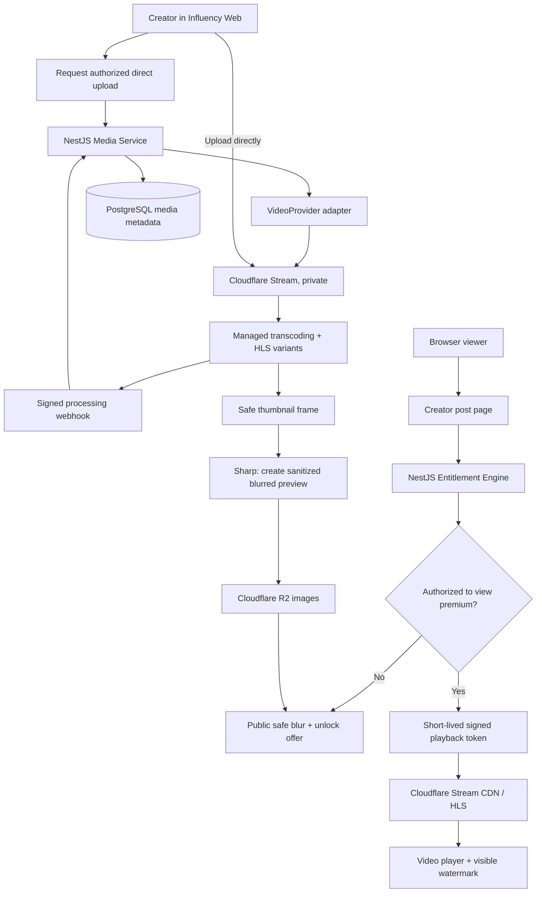

# INFLUENCY — VIDEO & MEDIA INFRASTRUCTURE
## MVP Technical Context, Cost Model, Content Protection & Implementation Plan

**Document version:** 1.0  
**Prepared:** 2026-11-03  
**Status:** Engineering handoff / proposed video subsystem (vendor **not yet finally locked**)  
**Intended reader:** Claude / Claude Code, backend/frontend developer, product owner  
**Project:** Influency — Web-first multi-creator exclusive content platform

> **Scope boundary.** This file is an ADDENDUM to the Influency MVP master context, focused on media storage, video streaming, thumbnail/blur, and content protection. It does **not** revert Influency to a Telegram Mini App. The platform remains **web-first** with Telegram OIDC login, one Influency bot for notifications, prepaid internal Koin, and a payment-gateway sandbox for MVP payment testing.

---

## 1. Executive summary

Influency needs affordable video hosting for a large, growing library of creator content, without losing paywall controls. Each creator may publish **free posts**, **paid individual posts with timed access** (example: 5 Koin / 7 days), and **creator-wide subscriptions** (example: 30 Koin / 30 days). Premium posts show a **safe public blurred preview** until a subscriber's entitlement is verified. A paid subscriber streams the full video in-browser without an exposed permanent public URL.

**Recommended MVP direction (proposal, not vendor lock):**

- **Cloudflare Stream** for managed video upload, encoding/transcoding, HLS/DASH delivery, CDN and signed playback.
- **Cloudflare R2 Standard** for thumbnails, blurred previews, creator avatars and other image assets. Use **Sharp** for generating sanitized preview variants; avoid CSS-only blur.
- **NestJS Media Service + Entitlement Engine** as the only authority to authorize premium video playback.
- **Next.js** web frontend with a video player, locked-post UX, and a **visible session watermark** as deterrence.
- **PostgreSQL** for ownership, asset states, video provider IDs, posts and entitlements. **Redis/BullMQ** as optional background jobs once necessary.
- Build a **VideoProvider adapter** from the start. Keep **Bunny Stream** as a cost-optimization candidate when streaming volume grows or the economics favor GB-based billing.
- Consider **R2 + FFmpeg + private HLS/CDN** only when measurements justify extra infrastructure complexity.

**Security truth:** Signed playback, origin restrictions and no-download UX **do not** prevent a legitimately authorized user from capturing, downloading via advanced tooling, screen-recording or filming the screen. Web apps generally cannot reliably detect/block operating-system screen recording. Browser overlay watermarking can deter casual redistribution but can be stripped by technical users. Evaluate full multi-DRM only in a later, separately budgeted phase.

**Critical business validation:** Confirm that the media provider, payment provider and applicable laws support the categories of creator-generated content being hosted. No provider is assumed to approve all types of adult/sexual material. Maintain strict content moderation, copyright/consent rules and takedown processes.

---

## 2. Locked global project context (not a proposal)

| Topic | Locked Influency decision |
|---|---|
| Primary runtime | Standalone public website; **web-first** |
| Creator URL | `https://influency.com/{creator_slug}` |
| Landing from Instagram | Instagram bio opens creator page in browser directly |
| Authentication | Telegram OpenID Connect (OIDC) for web login |
| Telegram bot | One official Influency bot used for opt-in notifications; creators have **no personal bots** |
| Monetization | Free posts, individually unlockable posts, creator-wide subscriptions |
| Internal currency | Prepaid Influency **Koin**; no user-to-user coin transfer |
| Payments | Third-party payment gateway; **Midtrans Snap Sandbox proposed for MVP tests**, not Lynk.id or Telegram Stars |
| Revenue | Influency receives gateway payments, records creator earnings after platform commission, manages payouts |
| MVP subscription renewal | Manual (no automatic recurring top-up or auto-debit) |
| Technology direction | TypeScript, Next.js frontend, NestJS backend, PostgreSQL; modular monolith |

> Do not implement Telegram WebApp `initData` as the primary web authentication, do not introduce creator-owned Telegram bots, and do not assume payment gateway live approval. The present document concerns the **video subsystem**, not changes to the above business architecture.

---

## 3. Media concepts and their costs

| Term | Plain-English definition | Effect on costs |
|---|---|---|
| **Video size** | Actual bytes of a file (MB/GB); depends on duration, bitrate, codec and resolution | GB-based storage + delivery, if billed by GB |
| **Stored GB / GB-month** | Average data held over a month | Repeated monthly storage charge until deleted |
| **Traffic / delivered GB** | Total video bytes sent to viewers during the month | May dominate costs for popular content |
| **Bandwidth (Mbps)** | Rate or network capacity, not the same as monthly traffic volume | Some plans bill for throughput, many charge per GB instead |
| **Egress** | Bytes leaving a storage/provider network | Can be free, metered, or included by product; CDN delivery may still cost |
| **CDN** | Distributed edge caches that deliver media near users | Improves playback and offloads origin; provider may meter requests/GB |
| **Replication point** | Geographic location holding another stored copy | May multiply or increase charged storage; not the same as a CDN cache node |
| **Transcoding** | Re-encode original into playable renditions/codecs/bitrates | Can cost CPU/minutes; creates additional bytes in a self-hosted system |
| **HLS** | HTTP Live Streaming; playlists (`.m3u8`) plus many segments | Adaptive quality; many segment requests; doesn't imply DRM |
| **ABR** | Adaptive bitrate: player switches rendition as connection changes | Reduces buffering, can control traffic |
| **Signed playback** | Short-lived token granting access to video/segments | Reduces unauthorized access but cannot fully block capture |
| **DRM** | Encrypted-media playback + licensed keys (Widevine/FairPlay/PlayReady) | Stronger capture resistance on supported devices; licensing, cost, integration complexity |

**Storage is not cumulative uploads forever:** 1 TB currently stored means about 1 TB of storage charged each month (prorated where applicable), even with zero new uploads. Monthly traffic is a separate recurring measurement and restarts for the next billing period.

---

## 4. Premium media model

Every published post references **media assets**, not raw public video URLs. A media asset can have multiple variants:

1. **`preview_blurred`**: low-resolution, permanently blurred/redacted public image (optionally a lock overlay); safe for viewers who have **not** purchased access.
2. **`thumbnail`**: clear image for owner/authorized viewer, or a separate intentionally selected safe cover if public. Do **not** expose a sensitive clear frame simply because it is called a thumbnail.
3. **`main_video`**: processed streaming video, private by default; served only after backend entitlement checks.
4. *(Optional)* **`poster_safe`**: curated non-sensitive public teaser cover; may replace public blur when moderation requires it.
5. *(Optional later)* **`original`**: archive/master retained only if business rules require re-processing or retrieval; not automatically duplicated in a second provider.

### Public locked state

- Public post feed may display title, creator, duration, price and `preview_blurred` or safe cover.
- **Never** expose an unblurred premium image or an unprotected video manifest/asset ID in an unauthenticated response.
- Do not rely on `filter: blur(...)` CSS for confidentiality. CSS blur does not remove underlying pixels.
- `preview_blurred` should be an actually transformed file (e.g., Sharp resize -> blur -> lossy WebP), ideally selected from a reviewed/safe frame.
- Generating previews from explicit/private frames might still reveal silhouettes or sensitive context: provide a creator-selectable safe cover and moderation rules.

### Authorized state

- On playback request, NestJS checks user identity, post ownership, active per-post entitlement, or active creator subscription.
- If authorized, issue a short-lived **signed playback token**, never a permanent public URL.
- On token expiry, frontend should re-request it only while current entitlement remains valid.
- Price and access duration are recorded at time of purchase; editing creator pricing does not retroactively delete previously purchased valid entitlements.

---

## 5. Provider comparison (pricing models, not apples-to-apples)

Official list rates checked **2026-11-03**. Rates can change, and final bill depends on region, quality ladder, rounding, caching, features, and contract.

| Provider | Storage model | Delivery model | Video stack included? | Assessment |
|---|---|---|---|---|
| **Cloudflare Stream** | **US$5 per 1,000 stored video minutes/month**, capacity purchased in increments | **US$1 per 1,000 minutes delivered** | Managed upload, encoding, CDN, HLS/DASH, player/signed tokens | Fastest implementation; minute-based costs rise with watch time |
| **Cloudflare R2 Standard** | **US$0.015/GB-month**, 10 GB-month free on Standard tier | R2 egress free; operations metered after free quota | **No** automated transcoding/HLS/private streaming workflow | Very economical object storage, but full pipeline must be built |
| **Bunny Stream** | From **US$0.01/GB** per region/replica | From **US$0.005/GB** with Volume network; plan/network matter | Managed encoding, CDN, player, token protection | Potentially very cheap for high watch volumes; test Indonesia latency |
| **Bunny Storage + Bunny CDN** | From US$0.01/GB in one Standard storage region | Separate CDN delivery charge | **No** full video-processing pipeline by itself | Custom pipeline alternative at scale |

**Cloudflare Stream specifics:** encoding and upload ingress included; multiple quality levels generated by Stream are not separately charged as R2 GB; delivery usage is counted by requested video segments, so prefetching/buffering can add billable minutes. Video assets require prepaid storage capacity. More information: https://developers.cloudflare.com/stream/pricing/.

**Cloudflare R2 Standard specifics:** Class A mutations **US$4.50/million**, Class B reads **US$0.36/million**, with free monthly allowances (1m Class A, 10m Class B). R2 Infrequent Access has lower storage price but retrieval fees and minimum storage duration; Standard is preferable for frequently viewed video/preview. More: https://developers.cloudflare.com/r2/pricing/.

**Bunny specifics:** listed prices are **from** rates. Volume network price may be lower than a region-priced Standard network but has fewer PoPs; test playback in Indonesia. Storage may be billed per replication region, and processed renditions contribute to physical usage. More: https://bunny.net/pricing/stream/ and https://bunny.net/pricing/.

**Not a conclusion:** R2's very low GB storage cost does not imply that an R2 video service is cheaper than Stream or Bunny after engineering time, FFmpeg servers, security/CDN routing, retries, monitoring, video player behavior, and request volumes.

---

## 6. Reproducible cost simulation

All figures are **illustrative monthly USD estimates, not quotes**. Scenario:

- `video_count = 1,000`
- `average_duration = 5 minutes`
- `stored_video_minutes = 5,000`
- `plays_per_month = 30,000`
- `average_view_time = 3 minutes/play`
- `delivered_minutes = 90,000`

### Cloudflare Stream

```
storage_capacity = ceil(5,000 / 1,000) * $5 = $25/month
delivery        = 90,000 / 1,000 * $1  = $90/month
TOTAL                                  = $115/month
```

### Cloudflare R2, storage-only reference (NOT comparable as complete streaming)

Assume `150 MB` of total stored encoding renditions per 5-minute video (all renditions together, not original) -> `150 GB` stored.

```
billable_storage = max(0, 150 - 10 free GB) = 140 GB
storage_cost     = 140 GB * $0.015 = $2.10/month
operation_cost   = usage-dependent (can be $0 if within free quotas)
FFmpeg CPU, orchestration, secure CDN/workers, media operations = NOT INCLUDED
```

### Bunny Stream — example only

Assume `150 GB` processed storage, 1 region, delivery to subscribers at average `2 Mbps` (`~15 MB/min`, decimal), 90,000 delivered minutes => `~1,350 GB` traffic.

```
storage = 150 GB * $0.01 = $1.50/month
delivery = 1,350 GB * $0.005 = $6.75/month
TOTAL (indicative, Volume tier) = $8.25/month
```

**Caution:** Bunny's actual processed-rendition storage and delivered bitrate must be measured. Above assumes one storage region, advertised minimum Volume price, no extra products, and an account whose monthly minimum is already met. It is a capacity comparison model, **not** a realistic guaranteed invoice.

### Scale examples — Cloudflare Stream only

| Scenario | Video count × avg duration | Minutes stored | Watched/delivered minutes monthly | Estimate |
|---|---:|---:|---:|---:|
| Early | 100 × 5 min | 500 | 6,000 | `$5 + $6 = $11` |
| Growing | 1,000 × 5 min | 5,000 | 90,000 | `$25 + $90 = $115` |
| Growth | 10,000 × 5 min | 50,000 | 900,000 | `$250 + $900 = $1,150` |
| Large | 50,000 × 5 min | 250,000 | 3,000,000 | `$1,250 + $3,000 = $4,250` |

Simplifications: full storage allocation, watch minutes approximate segment-based billed delivery, no contracts/discounts/taxes, and no separate R2 preview operations.

### Unit economics and guardrails

Track `stored_minutes`, `delivered_minutes`, `stored_gb`, `delivered_gb`, `cost_per_creator`, `cost_per_paid_post`, and `cost_per_revenue_earned`. Limit automatic feed video preloading/autoplay. A creator with huge playback and little revenue can cost more than a creator with a larger but rarely watched library.

---

## 7. Recommended Influency MVP media architecture



**Important implementation correction:** A video-provider URL/thumbnail can be private and require a token. Safe preview generation should occur via an **authorized server-side/admin media-processing path**, not by making the premium video publicly readable. Validate webhook authenticity and fetch authoritative asset metadata if webhook verification is incomplete.

### Upload workflow

1. Authenticated approved creator selects a video.
2. Backend validates ownership, MIME/format, size, duration policy, quotas, and metadata. Creator posts stay **draft** until media processing/moderation is complete.
3. Backend requests a provider **direct upload** session and saves an asset row `CREATED`.
4. Browser uploads straight to provider (resumable if needed); video bytes should not flow through NestJS.
5. Provider asynchronously encodes and reports `READY` or `ERROR`; backend verifies provider event, updates processing state **idempotently**, and records `provider_asset_id`, duration and metadata.
6. Generate a reviewed/selected safe cover, clear authorized thumbnail, and permanently blurred public preview. Store image variants and moderation decisions.
7. Publish the post only if asset and moderation state are valid.

### Playback workflow

1. Browser requests `GET /posts/:id` -> post metadata; an unauthorized user receives only safe public variants.
2. Authorized user requests `POST /media/:id/playback-session`.
3. Server validates session, post publication status, creator status, and current per-post or creator-wide entitlement (including expiry).
4. Server creates a short-lived Cloudflare Stream signed token (e.g., 10–30 minutes as an MVP policy), with **no downloadable claim**; return playback URL/token only to that user session.
5. Browser starts HLS playback; request fresh token for continued watching as required, rechecking entitlement.
6. Log an authorization event and player telemetry (start, error, buffering, approximate watched time).
7. Do not count **frontend-only** `onPlay` events as proof that a video was fully viewed or an invoice was paid.

---

## 8. Cloudflare Stream versus self-hosted R2 + FFmpeg

### Option A — Cloudflare Stream (MVP preferred for speed, simpler security)

**Included:** direct creator uploads, processing/transcoding, HLS/DASH, managed CDN and signed playback; provider-generated thumbnails. Own backend controls creator ownership, access permissions, previews and watermark overlay. No separate FFmpeg host needed for *video encoding*.

**Pros:** less engineering, manageable operational risk, fast route to a working premium video product.

**Cons:** minute-based storage capacity/delivery can grow expensive with high minutes watched; cannot tune every rendition/codec/storage trick; no documented built-in **universal anti-recording** guarantee.

### Option B — R2 + FFmpeg + CDN/Workers (later cost-optimization candidate)

**Architecture:** direct multipart upload -> private R2 original -> asynchronous FFmpeg workers -> multi-rendition HLS manifests+segments -> R2 processed assets -> Cloudflare CDN/Workers authorization -> player.

**Pros:** control of codec, bitrate ladder, file retention, compression, storage class and delivery implementation; R2 has no egress charge.

**Cons:** you own worker capacity, retries, encoding pipelines, safe caching, private manifest **and segment** authorization, signed cookies/tokens, key handling (if encryption), costs per request/CPU, monitoring, cleanup and incident response. Never point a client to a public bucket with sensitive HLS segments just because the manifest is protected.

**Trigger for reconsideration:** actual measurements show significant monthly Stream expenses and a clear cost advantage after **fully loaded** FFmpeg/cloud operations expenses and development time. Make a reproducible benchmark with sample videos and Indonesia viewer locations.

### Option C — Bunny Stream (parallel benchmark)

Managed transcoding + CDN + token protection with GB-based billing. May be much less costly at large delivered-minute volume, but account for actual encoded size, replication locations and the chosen Standard versus Volume CDN network. Playtest for startup delay/rebuffer ratio from mobile networks in Indonesia before migrating.

---

## 9. Security, anti-download, screenshots and screen recording

### Protection hierarchy

| Protection | What it actually does | Can it prevent user capture? |
|---|---|---|
| **Backend entitlement** | Stops unpaid/expired sessions from being issued playback access | Prevents *unauthorized viewing*, not recording by a paying user |
| **Signed playback token** | Limits video access by valid token and expiry | No; token can be used while valid if obtained |
| **Allowed origins** | Restricts playback embedding/request origins | No; not a screen recorder defense |
| **Disable download option** | Prevents official MP4-download route being authorized | No; browser still receives video data to play it |
| **HLS streaming** | Sends playlist+segments and supports adaptive bitrate | No; HLS is not DRM |
| **Watermark overlay** | Visible session/user code deters and helps investigate leaks | No; HTML overlay can be removed by technical users |
| **Native Android FLAG_SECURE** | Stops many OS captures in Android **native app** | Not available to ordinary Influency web sessions |
| **DRM (Widevine/FairPlay)** | Protects encrypted playback paths on compatible clients | Better, but not absolute; requires supported playback stack and licensing |

**Web limitation:** Neither a normal website nor Cloudflare Stream alone can reliably detect or disable OS screen recording/screenshot across Android, iOS, Chrome, Safari and Instagram in-app browsers. `display-capture` permissions policy is **not** a universal anti-screenshot control. Physical cameras can film the display even with native secure-display features.

### Recommended MVP measures

1. Every premium asset uses `requireSignedURLs=true` (or equivalent provider setting).
2. Video segments and manifests should **not** be public through a different route.
3. Server checks entitlement **before** issuing any playback token; no trust in frontend `isPremium` booleans.
4. Tokens have bounded expiry; retry/renew through backend on long playback sessions.
5. Do not generate public downloadable MP4s; do not set `downloadable:true` when issuing Stream tokens.
6. Set allowed origins to Influency domains, with staged-domain handling for test environment.
7. Add visible session-based watermark (pseudonymous user/session code, optional coarse timestamp); position changes occasionally. Avoid exposing personally identifying data.
8. Log playback authorization, failed entitlements, suspicious use and token issuance in privacy-conscious, time-limited audit logs.
9. Implement rate limiting on playback-session endpoint; consider concurrent-session policies **without falsely claiming DRM-level security**.
10. Provide a copyright/consent complaint process and moderation workflow.

### Watermark implementation tiers

- **MVP low-cost:** Render an HTML/CSS watermark **above** the player. Cheap and easy, but removable with developer tools, may not appear in capture scenarios where only the video surface is recorded.
- **Intermediate:** Provider-side composited watermark or per-user pre-rendered assets (higher processing/storage cost; assess provider capabilities).
- **Advanced:** Forensic watermarking integrated into an eligible DRM delivery workflow; high complexity/cost, not MVP.

---

## 10. Backend technical contracts and suggested database model

**Important:** these are suggested interfaces and implementation guidelines, **not confirmed existing code**.

```typescript
export type VideoAssetStatus =
  | 'CREATED'
  | 'UPLOADING'
  | 'PROCESSING'
  | 'READY'
  | 'FAILED'
  | 'BLOCKED'
  | 'DELETED';

export interface VideoProvider {
  createDirectUpload(input: {
    creatorId: string;
    requestedMaxDurationSec: number;
    contentType?: string;
    correlationId: string;
  }): Promise<{
    providerAssetId?: string;
    uploadUrl: string;
    expiresAt?: Date;
    providerUploadId?: string;
  }>;

  getAsset(assetId: string): Promise<{
    status: 'processing' | 'ready' | 'error';
    durationSec?: number;
    width?: number;
    height?: number;
  }>;

  createPlaybackToken(input: {
    providerAssetId: string;
    expiresAt: Date;
    allowDownload: false;
  }): Promise<{ token: string; playbackUrl: string }>;

  deleteAsset(assetId: string): Promise<void>;
}
```

**Suggested entities:**

- `media_assets`: `id`, `creator_id`, `media_type`, `provider`, `provider_asset_id`, `upload_status`, `processing_status`, `duration_seconds`, `source_mime`, `source_size_bytes`, `width`, `height`, `created_at`, `ready_at`, `deleted_at`.
- `media_variants`: `id`, `asset_id`, `type` (`thumbnail`, `preview_blurred`, `poster_safe`, etc.), `storage_provider`, `object_key`, `visibility`, `bytes`, `width`, `height`.
- `post_media`: `post_id`, `asset_id`, `sort_order`; keep media assets separate from posts to avoid redundant uploads.
- `playback_sessions`: `id`, `user_id`, `asset_id`, `post_id`, `issued_at`, `expires_at`, `watermark_code`, `result`, optional privacy-preserving anomaly fields.
- `media_processing_jobs` (optional): idempotent job state and provider webhook correlation.
- Existing `posts`, `content_entitlements`, `creator_subscriptions` remain the authority for paywall rights.

**Public API examples:**

```
POST /media/direct-uploads
GET  /media/:assetId/status
POST /media/:assetId/playback-session
GET  /posts/:postId
POST /webhooks/media/cloudflare
GET  /creator/media-library
DELETE /media/:assetId
```

**Implementation rules:** validate creator ownership and authenticated session; authorize media upload/deletion; never accept arbitrary `creator_id` or `provider_asset_id` from client as authoritative. Use HTTPS, narrow access roles, bucket lifecycle policies, idempotent callbacks, and secrets in a server-side secret store. Plan an appropriate asset cleanup/grace period when creators delete posts; beware asset reuse across multiple posts.

---

## 11. Frontend UX guidance (mobile-first)

**Creator upload screen:** select video -> upload progress -> "Processing" -> preview status -> choose safe cover -> set `Free/Premium`, Koin price and access duration -> Publish. Disable publication until media readiness and moderation requirements pass.

**Free feed:** clear approved thumbnail, optional short autoplay only under deliberate traffic policy; avoid downloading full video for off-screen cards.

**Premium locked feed:** safe blurred or curated cover + price/duration/unlock button; no premium HLS playlist or private thumbnail URLs in page source/data.

**Authorized post:** authenticated player, visible pseudonymous session watermark, quality auto-switch, concise error/retry screen, token refresh on expiry, optional remaining entitlement period in UI.

**In-app browser:** optimize 9:16 playback, touch controls and behavior in Instagram's in-app browser, Chrome Android and Safari iOS. The product is web-first; do **not** require Telegram to open the page (Telegram OIDC only when login is needed).

---

## 12. Testing & acceptance criteria

### Functional tests

- [ ] Creator can upload allowed video without streaming bytes through NestJS.
- [ ] Invalid media, exceeded quotas, and interrupted uploads fail cleanly; orphaned uploads are cleaned up.
- [ ] Processing status moves correctly from creation to ready/error; duplicate provider webhook is harmless.
- [ ] Clear premium poster/thumbnail cannot be fetched by an unpaid user unless explicitly curated/public.
- [ ] Public blurred preview is an actually transformed distinct file; removing CSS does not reveal original.
- [ ] A user with no entitlement cannot request a playable manifest/token; backend returns 401/403 as appropriate.
- [ ] User with individual unlock can watch until expiry, then is denied new access.
- [ ] User with active creator-wide subscription can watch premium posts from that creator only.
- [ ] User can continue a legitimate long playback with token refresh while entitlement remains valid.
- [ ] Sharing an unsigned/persistent video URL does not grant premium playback.
- [ ] Player does not advertise premium MP4 download; explicit downloadable token is never issued.
- [ ] Watermark visible on normal player; document bypass limitations accurately.
- [ ] Deletion preserves referential integrity for assets reused in multiple posts.

### Performance & cost tests

- [ ] Upload 5-minute 9:16 mobile videos with weak network/resume.
- [ ] Test startup time, buffering and failed segments on Indonesian 4G/5G, iOS Safari, Android Chrome, Instagram browser.
- [ ] Measure actual bytes/minute delivered by 480p/720p/1080p with 2–3 representative video genres.
- [ ] Measure R2 thumbnails/preview sizes and operation counts.
- [ ] Verify CDN settings and signed token expiry behavior at scale.
- [ ] Create daily spend alerts, watch-minute dashboards and per-creator usage reporting.

### Abuse/security tests

- [ ] Unauthorized user cannot call playback-session for premium asset.
- [ ] Creator cannot fetch/delete another creator's private media.
- [ ] Expired subscription cannot issue new token.
- [ ] Token reuse from other domains tested with allowed-origin settings; document residual risk.
- [ ] Static preview has no private/original URL or recoverable clear image.
- [ ] Audit logs do not store full bearer tokens or secret values.
- [ ] Verify provider webhook authenticity/correlation; replayed events cannot regress asset state.

---

## 13. MVP decision matrix and recommendation

| Criterion | Stream + R2 | Bunny Stream + R2 | R2 + FFmpeg |
|---|---|---|---|
| Development effort | **Low** | **Low** | High |
| Managed transcoding | Yes | Yes | No |
| Managed streaming CDN | Yes | Yes | Must engineer/configure |
| Provider-native signed video access | Yes | Yes, via provider token controls | Must design carefully |
| Pricing basis | Stored/delivered minutes | GB stored/GB delivered | GB storage, requests + compute/CDN |
| Cost at very high watch volume | May rise materially | Often competitive, benchmark | Potentially low but high engineering cost |
| MVP recommendation | **Preferred for fastest reliable prototype** | **Cost benchmark / viable alternative** | Later, only after measured break-even |

**Decision status:** Video vendor remains **open pending actual upload/playback benchmark and policy review**. Do not silently treat an earlier discussion's preference for Bunny or Stream as legally/operationally final. For an engineering-first prototype, start with `CloudflareStreamProvider` behind `VideoProvider`, while preserving the option to implement `BunnyStreamProvider` later.

**Separate "media platform choice" from "content security guarantee".** Neither vendor provides an absolute browser anti-screenshot / anti-screen-record switch.

---

## 14. Suggested implementation sequence for Claude Code

**Phase V0 — Contracts and scaffolding**  
Define media entities, statuses, `VideoProvider`, access-control contract, environment variables, metadata migration, and test fakes. The existing Influency auth/entitlement code must be inspected before integration.

**Phase V1 — Upload pipeline**  
Direct uploads -> processing updates -> safe thumbnail/blur -> publishable asset. Implement webhook verification, retry handling, audit events and deletion lifecycle.

**Phase V2 — Premium playback**  
Backend entitlement check -> signed playback token -> HLS player -> short-lived session -> watermark overlay. Validate logged-out, expired, creator-owner, and paid-user cases.

**Phase V3 — Cost and operations**  
Monitor stored/delivered minutes and GB; set quota/budget alerts; measure costs and bitrate behavior; trial Bunny Stream using the same sample videos if warranted.

**Phase V4 — Optional security enhancements**  
Token refresh/session limits, configurable watermark style, additional suspicious-session telemetry. Multi-DRM and forensic watermarking are explicitly **out of scope for MVP**.

---

## 15. Decisions still to confirm (do not invent defaults as product policy)

1. Maximum per-video upload size and duration, supported aspect ratios/resolutions.
2. Retention period for original source video, including deletion/appeals/backups.
3. Whether clear thumbnail may be public or only an approved safe cover is public.
4. Trial / provider approval for the allowed creator content categories.
5. Cloudflare Stream vs Bunny benchmark using real footage and Indonesian networks.
6. Per-creator storage/upload quota and overage policies.
7. Watermark code format, visibility, position movement and privacy retention.
8. Playback session/token lifetime and renewal strategy for long videos.
9. Moderation requirements for private/public media and takedown SLAs.
10. Budget ceiling, analytics, backups, deletion behavior, and incident response.

---

## 16. Official technical sources (reviewed Nov 3, 2026)

- Cloudflare Stream pricing — https://developers.cloudflare.com/stream/pricing/
- Cloudflare R2 pricing — https://developers.cloudflare.com/r2/pricing/
- Cloudflare Stream secure/signed playback — https://developers.cloudflare.com/stream/viewing-videos/securing-your-stream/
- Cloudflare Stream thumbnails — https://developers.cloudflare.com/stream/viewing-videos/displaying-thumbnails/
- Cloudflare Stream download controls — https://developers.cloudflare.com/stream/viewing-videos/download-videos/
- Cloudflare Stream direct uploads — https://developers.cloudflare.com/stream/uploading-videos/
- Cloudflare Stream processing webhooks — https://developers.cloudflare.com/stream/manage-video-library/using-webhooks/
- Bunny Stream pricing — https://bunny.net/pricing/stream/
- Bunny CDN pricing (Standard vs Volume) — https://bunny.net/pricing/
- Bunny Storage pricing/replication — https://bunny.net/pricing/storage/

Vendor documentation/fees may change. Re-verify before commitment. These sources support the provider features and public list prices; they **do not** prove that Influency will pass content-policy review or achieve a particular final invoice.

---

## 17. Suggested Claude Code kickoff prompt

> Read this entire document as the video subsystem addendum to the Influency MVP master handoff. Preserve all **locked web-first, Telegram OIDC, payment gateway sandbox, Koin, creator, subscription and entitlement requirements** from the master context. Audit the repository before changes. Design `VideoProvider` and media schema so Cloudflare Stream is the initial prototype provider, with Bunny Stream replaceable later. Start by presenting the media module interfaces, schema, upload/processing/playback sequence diagrams, security boundaries, cost instrumentation and test plan. Then implement incrementally, verifying that public locked previews cannot expose clear premium frames or playable video URLs, that no unsigned premium video access exists, and that signed playback cannot be mistaken for a guarantee against screen recording. Do not make vendor, financial, moderation or privacy decisions on behalf of the product owner.

